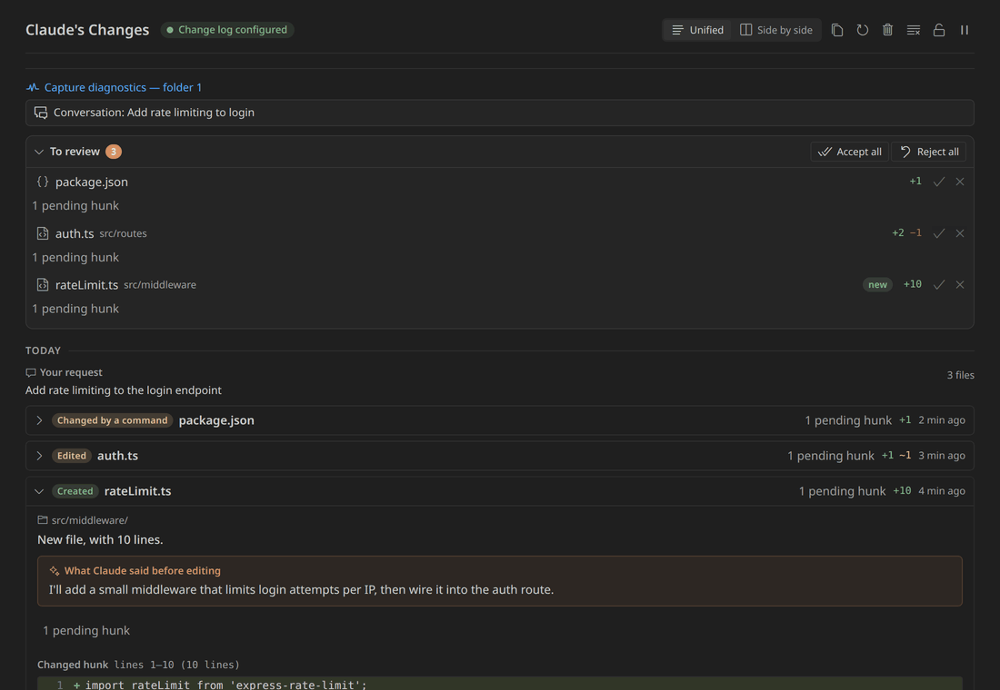
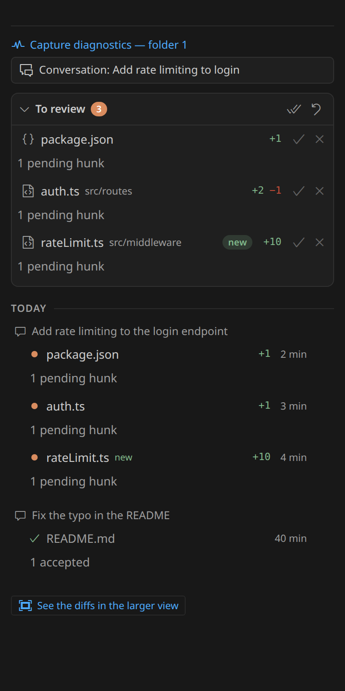
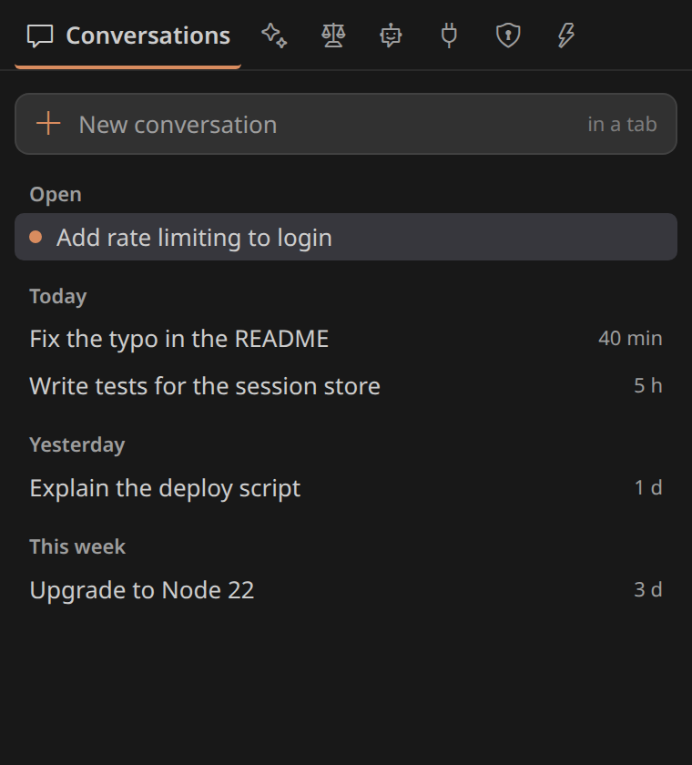
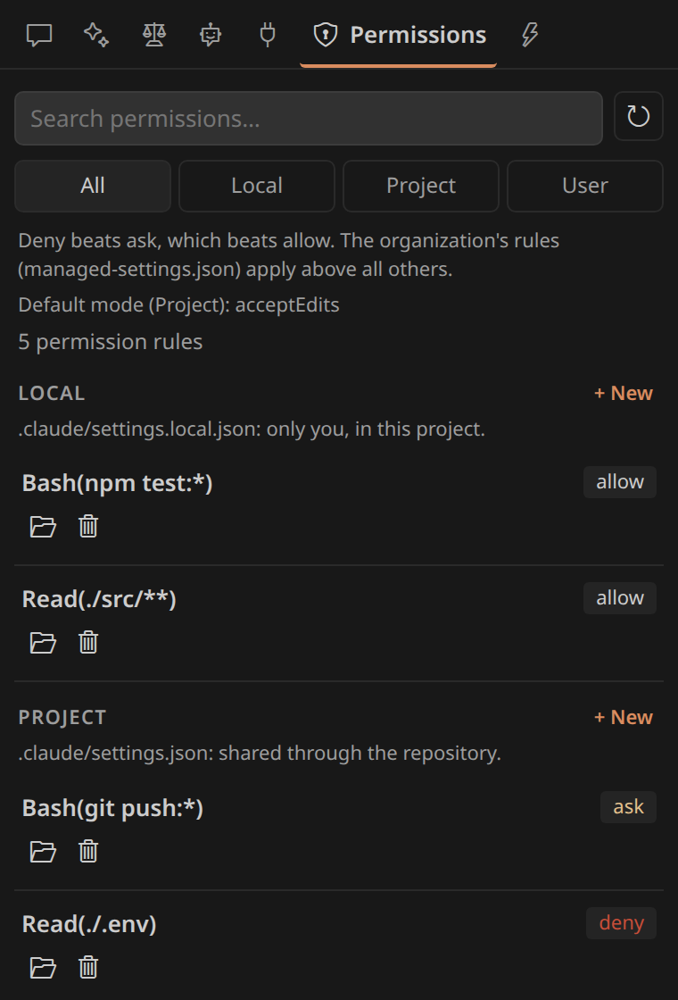

# Launcher for Claude Code

[Leia em português](https://github.com/KauanCarolino/Extension-Claude-Code-Launcher/blob/main/README.pt-BR.md)

Opens the official Claude Code chat in VS Code and Cursor and shows, file by file, what Claude changed, so you can accept or reject each change.

Independent extension: it is not made or maintained by Anthropic. "Claude" and "Claude Code" are trademarks of Anthropic.

## What it does

- **Opens the chat** in the sidebar or in editor tabs, from the icon in the editor title or the **Claude** item in the status bar. In Cursor, where the Claude Code sidebar ends up inside the Explorer, these shortcuts show the chat in a tab instead. The launcher view lists the project's conversations so you can resume any of them.
- **Reviews Claude's changes.** Every file Claude edits shows up in **Changes**, grouped by your request, with the diff and what Claude said before editing. Accept or reject a whole file, a single hunk or a whole request, in the panel or right in the editor, and undo a reject.
- **Captures what commands changed.** Formatters, `npm install`, code generators and MCP tools change files without going through Claude's edit tools. At the end of each Claude reply, the launcher compares the project with how it was when you sent the request and lists those changes as **Changed by a command**, ready to review and reject.
- **Copies a summary for your PR.** One click puts a Markdown summary of the changes, grouped by request, on the clipboard.
- **Manages skills, rules, agents, MCP servers, permissions and hooks** in tabs of their own, including in multi-root workspaces.

Chat, sign-in, models and permissions stay with the official **Claude Code** extension (`anthropic.claude-code`).

| Changes in the sidebar | Conversations | Permissions |
| --- | --- | --- |
|  |  |  |

## Getting started

The walkthrough (**Launcher for Claude Code: Open the Walkthrough**) opens on install and takes you through these steps:

1. Install the official Claude Code extension. The launcher offers an **Install** button.
2. Open the project folder.
3. Run **Turn On Change Log**. The hook runs with `node`, so Node.js must be on your `PATH`.
4. Start a **new** conversation and ask for an edit. Claude loads hooks when a conversation starts, so conversations that were already open record nothing.
5. Review the change in **Changes** or in the editor.

| Shortcut | Windows and Linux | macOS |
| --- | --- | --- |
| Next / previous hunk by Claude | `Alt+]` / `Alt+[` | `Ctrl+Alt+]` / `Ctrl+Alt+[` |
| Accept / reject the hunk at the cursor | `Alt+Shift+Y` / `Alt+Shift+N` | `Ctrl+Alt+Y` / `Ctrl+Alt+N` |

## Privacy and local data

- Everything stays on your disk. Nothing is sent to an external service.
- The change log adds hooks to the project's `.claude/settings.local.json` and keeps copies in `.claude/launcher-changes/`, which gets its own `.gitignore`. The hook only observes: it never approves or blocks a tool, and it never runs anything from your project.
- To capture what commands changed, the hook notes the project state when you send a request and keeps copies of text files, within half of the storage budget and up to 2,000 files. `.git`, `node_modules`, `.claude` and what the project's `.gitignore` files list (in any folder, with `!` negations) are skipped. Turn it off with `claudeCodeLauncher.captureCommandChanges`.
- `.env` files, private keys, certificates and credential files are never copied (`claudeCodeLauncher.historyExcludedPatterns`). Reviewed history is cleaned up after 30 days.
- Changes made outside Claude (by you or other programs) are not captured.

## Remote windows, WSL and containers

The launcher runs where your workspace is, like the official extension: in WSL, over SSH or in a dev container, the hook uses that machine's `node` and conversations live in that machine's `~/.claude`. Install Node.js 22+ there. **Reveal in file manager** reveals in the Explorer instead (or copies the path), and where the file system has no trash, rejecting a created file stops and asks you to delete it by hand: the launcher never deletes permanently.

## Requirements

- VS Code 1.94 or later, or a compatible Cursor.
- The official Claude Code extension.
- Node.js 22 or later on the `PATH` of the machine where the workspace is, for the change log.
- A trusted workspace. The launcher stays off in Restricted Mode.

## Settings

| Setting | Default | What it does |
| --- | --- | --- |
| `claudeCodeLauncher.language` | `auto` | Interface language: `auto` follows the editor (Portuguese or English), or pick `en` or `pt-br` |
| `claudeCodeLauncher.inlineChanges` | `true` | Shows review markers in the editor |
| `claudeCodeLauncher.captureCommandChanges` | `true` | Also captures what terminal commands, MCP tools and generators changed |
| `claudeCodeLauncher.historyExcludedPatterns` | sensitive files | Paths that are never copied into the history |
| `claudeCodeLauncher.historyRetentionDays` | `30` | Days to keep reviewed history; `0` keeps it |
| `claudeCodeLauncher.historyMaxStorageMB` | `128` | Storage budget; new captures pause when it is reached |
| `claudeCodeLauncher.manageEditorGroups` | `false` | Lets the launcher keep file tabs out of the chat's editor group |
| `claudeCodeLauncher.showStatusBarItem` | `true` | Shows the **Claude** item in the status bar |
| `claudeCodeLauncher.hookExecutionMode` | `auto` | How the hook is registered; `disabled` turns it off |

## Learn more

- [Full reference](https://github.com/KauanCarolino/Extension-Claude-Code-Launcher/blob/main/docs/REFERENCE.md): review semantics, command capture, capture diagnostics, local data, remote windows, recovery and development.
- [What the tests prove](https://github.com/KauanCarolino/Extension-Claude-Code-Launcher/blob/main/docs/VERIFICATION.md).
- [Changelog](https://github.com/KauanCarolino/Extension-Claude-Code-Launcher/blob/main/CHANGELOG.md).

Licensed under MIT.
