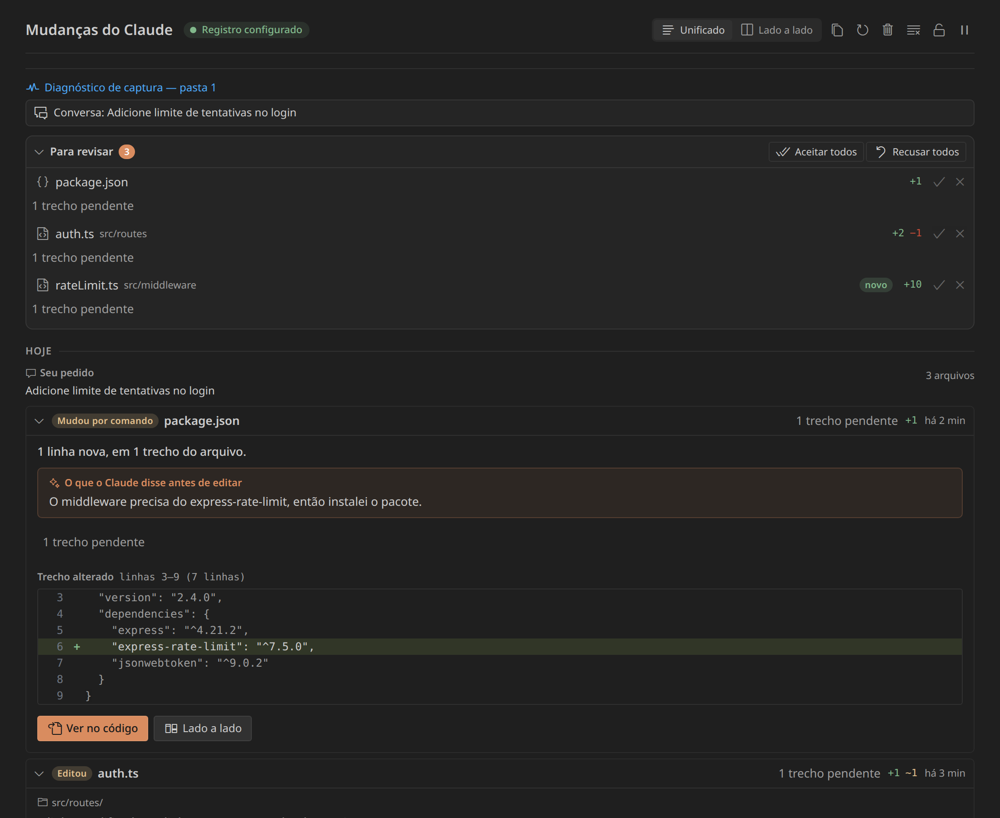
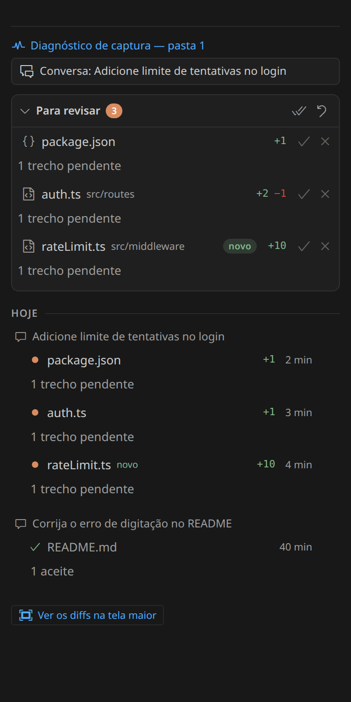
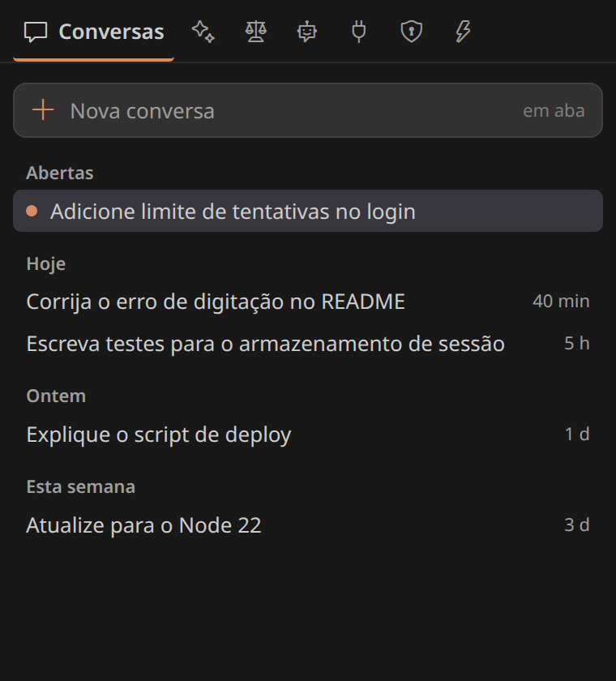
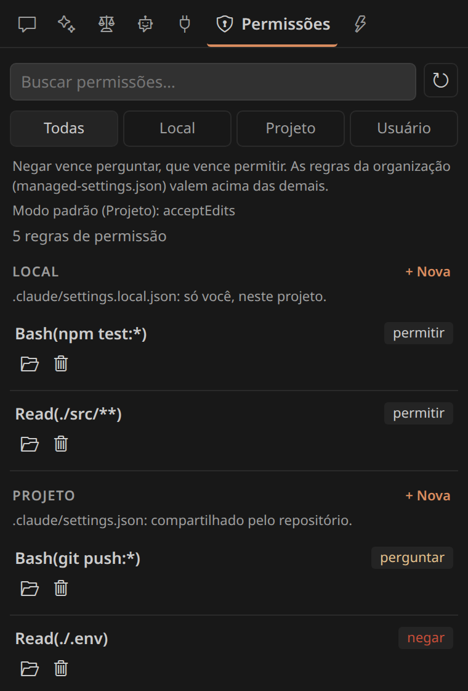

# Launcher for Claude Code

[Read in English](https://github.com/KauanCarolino/Extension-Claude-Code-Launcher/blob/main/README.md)

Abre o chat oficial do Claude Code no VS Code e no Cursor e mostra, arquivo por arquivo, o que o Claude mudou, para você aceitar ou recusar cada mudança.

Extensão independente: não é feita nem mantida pela Anthropic. "Claude" e "Claude Code" são marcas da Anthropic.

## O que ela faz

- **Abre o chat** na barra lateral ou em abas do editor, pelo ícone no título do editor ou pelo item **Claude** na barra de status. No Cursor, onde a barra lateral do Claude Code fica dentro do Explorer, esses atalhos mostram o chat em aba. A view do launcher lista as conversas do projeto para você retomar qualquer uma.
- **Revisa as mudanças do Claude.** Cada arquivo que o Claude edita aparece em **Mudanças**, agrupado pelo seu pedido, com o diff e o que ele disse antes de editar. Aceite ou recuse o arquivo inteiro, um trecho ou o pedido inteiro, no painel ou direto no editor, e desfaça uma recusa.
- **Captura o que os comandos mudaram.** Formatadores, `npm install`, geradores de código e ferramentas MCP mudam arquivos sem passar pelas ferramentas de edição do Claude. Ao fim de cada resposta, o launcher compara o projeto com o estado do momento em que você enviou o pedido e lista essas mudanças como **Mudou por comando**, prontas para revisar e recusar.
- **Copia um resumo para o PR.** Um clique põe na área de transferência um resumo em markdown das mudanças, agrupado por pedido.
- **Gerencia skills, regras, agentes, servidores MCP, permissões e hooks** em abas próprias, inclusive em workspaces com várias pastas.

O chat, o login, os modelos e as permissões continuam com a extensão oficial **Claude Code** (`anthropic.claude-code`).

| Mudanças na barra lateral | Conversas | Permissões |
| --- | --- | --- |
|  |  |  |

## Começando

O passo a passo (**Launcher for Claude Code: Abrir o passo a passo**) abre na instalação e percorre estas etapas:

1. Instalar a extensão oficial do Claude Code. O launcher oferece o botão **Instalar**.
2. Abrir a pasta do projeto.
3. Executar **Ativar registro de mudanças**. O hook roda com `node`, então o Node.js precisa estar no `PATH`.
4. Começar uma conversa **nova** e pedir uma edição. O Claude carrega os hooks ao iniciar a conversa; as que já estavam abertas não registram nada.
5. Revisar a mudança em **Mudanças** ou no editor.

| Atalho | Windows e Linux | macOS |
| --- | --- | --- |
| Próximo / anterior trecho do Claude | `Alt+]` / `Alt+[` | `Ctrl+Alt+]` / `Ctrl+Alt+[` |
| Aceitar / recusar o trecho no cursor | `Alt+Shift+Y` / `Alt+Shift+N` | `Ctrl+Alt+Y` / `Ctrl+Alt+N` |

## Privacidade e dados locais

- Tudo fica no seu disco. Nada é enviado a serviço externo.
- O registro adiciona hooks ao `.claude/settings.local.json` do projeto e guarda as cópias em `.claude/launcher-changes/`, que ganha um `.gitignore` próprio. O hook só observa: ele nunca aprova nem bloqueia uma ferramenta, e nunca executa nada do seu projeto.
- Para capturar o que os comandos mudaram, o hook anota o estado do projeto quando você envia o pedido e guarda cópias dos arquivos de texto, dentro de metade do orçamento de armazenamento e até 2.000 arquivos. `.git`, `node_modules`, `.claude` e o que os `.gitignore` do projeto listam (em qualquer pasta, com negações `!`) ficam de fora. Para desligar: `claudeCodeLauncher.captureCommandChanges`.
- Arquivos `.env`, chaves privadas, certificados e arquivos de credenciais nunca são copiados (`claudeCodeLauncher.historyExcludedPatterns`). O histórico revisado é limpo depois de 30 dias.
- Mudanças feitas fora do Claude (por você ou por outros programas) não são capturadas.

## Janelas remotas, WSL e contêineres

O launcher roda onde o workspace está, como a extensão oficial: no WSL, por SSH ou num dev container, o hook usa o `node` dessa máquina e as conversas ficam no `~/.claude` dela. Instale o Node.js 22+ lá. **Mostrar no sistema** passa a revelar no Explorer (ou copia o caminho), e onde o sistema de arquivos não tem lixeira, recusar um arquivo criado para e pede que você o apague à mão: o launcher nunca apaga em definitivo.

## Requisitos

- VS Code 1.94 ou mais novo, ou um Cursor compatível.
- A extensão oficial Claude Code.
- Node.js 22 ou mais novo no `PATH` da máquina onde está o workspace, para o registro de mudanças.
- Workspace confiável. No Restricted Mode, o launcher fica desligado.

## Configurações

| Configuração | Padrão | O que faz |
| --- | --- | --- |
| `claudeCodeLauncher.language` | `auto` | Idioma da interface: `auto` segue o editor (português ou inglês), ou escolha `en` ou `pt-br` |
| `claudeCodeLauncher.inlineChanges` | `true` | Mostra as marcas da revisão no editor |
| `claudeCodeLauncher.captureCommandChanges` | `true` | Captura também o que comandos de terminal, ferramentas MCP e geradores mudaram |
| `claudeCodeLauncher.historyExcludedPatterns` | arquivos sensíveis | Caminhos que nunca são copiados para o histórico |
| `claudeCodeLauncher.historyRetentionDays` | `30` | Dias de histórico revisado; `0` mantém tudo |
| `claudeCodeLauncher.historyMaxStorageMB` | `128` | Orçamento de armazenamento; ao atingi-lo, novas capturas pausam |
| `claudeCodeLauncher.manageEditorGroups` | `false` | Deixa o launcher tirar abas de arquivo do grupo do chat |
| `claudeCodeLauncher.showStatusBarItem` | `true` | Mostra o item **Claude** na barra de status |
| `claudeCodeLauncher.hookExecutionMode` | `auto` | Como o hook é registrado; `disabled` desliga |

## Mais detalhes

- [Referência completa](https://github.com/KauanCarolino/Extension-Claude-Code-Launcher/blob/main/docs/REFERENCIA.md): semântica da revisão, captura por comando, diagnóstico de captura, dados locais, janelas remotas, recuperação e desenvolvimento.
- [O que os testes comprovam](https://github.com/KauanCarolino/Extension-Claude-Code-Launcher/blob/main/docs/VERIFICACAO.md).
- [Changelog](https://github.com/KauanCarolino/Extension-Claude-Code-Launcher/blob/main/CHANGELOG.pt-BR.md).

Licença MIT.
